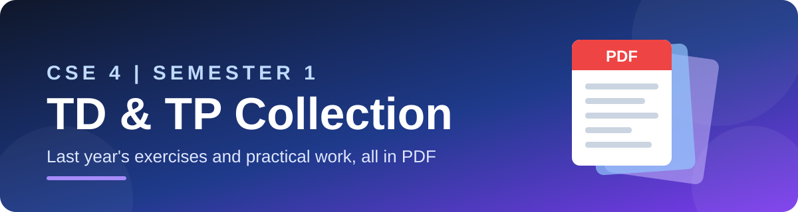
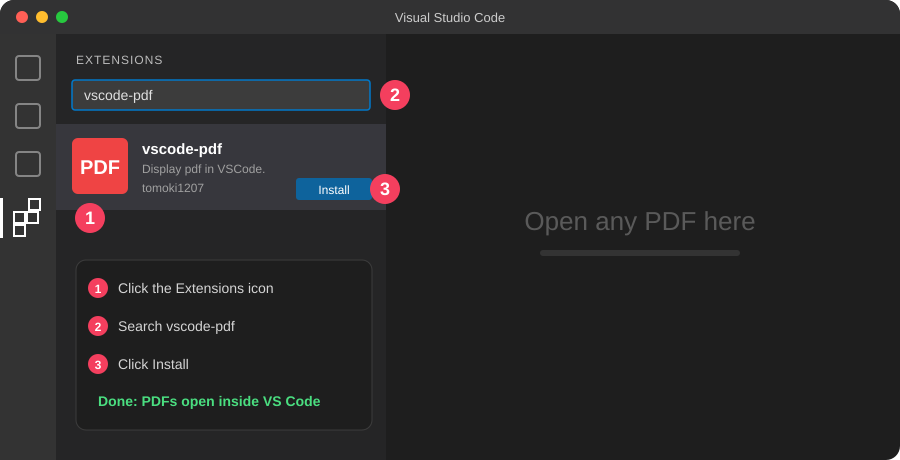

<p align="center">
  
</p>

<p align="center">
  
  
  
  
</p>

<p align="center">
  <b>All the TD and TP of last year's CSE 4 (Semester 1) in one place.</b><br/>
  Revise, practice, and prepare for your exams.
</p>

---

## 📌 Table of Contents

1. [What is this repo?](#-what-is-this-repo)
2. [Quick start (3 steps)](#-quick-start-3-steps)
3. [Repository structure](#-repository-structure)
4. [Get the files](#-step-1--get-the-files)
5. [Install the PDF viewer in VS Code](#-step-2--install-the-pdf-viewer-in-vs-code)
6. [Open and read the PDFs](#-step-3--open-and-read-the-pdfs)
7. [Troubleshooting](#-troubleshooting)
8. [Contributing](#-contributing)

---

## 🎯 What is this repo?

| | Type | Meaning | Format |
|---|---|---|---|
| 📝 | **TD** | *Travaux Dirigés*: exercise sheets | PDF |
| 🧪 | **TP** | *Travaux Pratiques*: practical work | PDF |

- 📅 **Year:** last year
- 🎓 **Level:** CSE 4, Semester 1
- 📄 **Content:** PDF files only, nothing to compile or run

---

## ⚡ Quick start (3 steps)

<p align="center">
  
</p>

---

## 📁 Repository structure

```text
CSE-4-S1-TD-TP/
│
├── 📂 TD/              ← exercise sheets
│   ├── 📄 TD1.pdf
│   ├── 📄 TD2.pdf
│   └── 📄 ...
│
├── 📂 TP/              ← practical work
│   ├── 📄 TP1.pdf
│   ├── 📄 TP2.pdf
│   └── 📄 ...
│
├── 📂 assets/          ← images used in this README
└── 📄 README.md        ← you are here
```

> 💡 File names may differ a little. Just open the folder and pick the PDF you need.

---

## 📥 Step 1 · Get the files

Choose **one** of the two options.

<table>
<tr>
<td width="50%" valign="top">

### 🅰️ Download ZIP
*Easiest, no Git needed*

1. Click the green **Code** button at the top of this page
2. Click **Download ZIP**
3. Extract the ZIP on your computer

</td>
<td width="50%" valign="top">

### 🅱️ Clone with Git
*Best if you want updates*

```bash
git clone https://github.com/dalil2005/CSE-4-S1-TD-TP.git
cd CSE-4-S1-TD-TP
code .
```

The last command opens the folder in VS Code.

</td>
</tr>
</table>

---

## 🧩 Step 2 · Install the PDF viewer in VS Code

VS Code cannot show PDF files by default. Install the free **vscode-pdf** extension to read them directly inside the editor.

<p align="center">
  
</p>

| | |
|---|---|
| 🏷️ **Name** | vscode-pdf |
| 👤 **Author** | tomoki1207 |
| 🔑 **ID** | `tomoki1207.pdf` |

Pick **one** method:

<details open>
<summary><b>✅ Method 1: Extensions panel (recommended)</b></summary>

<br/>

| Step | Action |
|:---:|---|
| **1** | Open VS Code |
| **2** | Click the **Extensions** icon on the left sidebar, or press `Ctrl` + `Shift` + `X` |
| **3** | Type **`vscode-pdf`** in the search bar |
| **4** | Choose **vscode-pdf** by **tomoki1207** |
| **5** | Click **Install** |

</details>

<details>
<summary><b>⌨️ Method 2: VS Code terminal</b></summary>

<br/>

Open the terminal with `` Ctrl+` `` and run:

```bash
code --install-extension tomoki1207.pdf
```

</details>

<details>
<summary><b>🚀 Method 3: Quick Open</b></summary>

<br/>

1. Press `Ctrl` + `P`
2. Paste this and press **Enter**:

```text
ext install tomoki1207.pdf
```

</details>

> 🍎 **Mac users:** use `Cmd` instead of `Ctrl`.

---

## 📖 Step 3 · Open and read the PDFs

1. In the VS Code **Explorer** (left panel), open the `TD` or `TP` folder
2. Click any `.pdf` file
3. It opens in a tab, ready to read ✅

| Want to... | Do this |
|---|---|
| 🔍 Search inside a PDF | `Ctrl` + `F` |
| 🔎 Zoom in / out | `Ctrl` + `+` / `Ctrl` + `-` |
| 📑 Open two PDFs side by side | Drag one tab to the right |

---

## 🛠️ Troubleshooting

<details>
<summary><b>The PDF does not open in VS Code</b></summary>

<br/>

- Check that the extension is installed: Extensions panel → search `vscode-pdf` → it should say *Installed*
- Reload VS Code: `Ctrl` + `Shift` + `P` → type **Developer: Reload Window**

</details>

<details>
<summary><b>The <code>code</code> command is not recognized</b></summary>

<br/>

Open VS Code → `Ctrl` + `Shift` + `P` → run **Shell Command: Install 'code' command in PATH** (Mac), or reinstall VS Code and tick *Add to PATH* (Windows).

</details>

<details>
<summary><b>I see a blank page instead of the PDF</b></summary>

<br/>

Close the tab, reload the window, and open the file again. If it still fails, the PDF may be corrupted: download it again.

</details>

---

## 🤝 Contributing

Got a missing TD or TP, or a better scan?

1. 🍴 **Fork** the repository
2. 📂 Add your PDF to the right folder (`TD/` or `TP/`)
3. 📬 Open a **Pull Request**

---

## ⚠️ Disclaimer

These files are shared **for educational purposes only**. All rights belong to their original authors and teachers.

---

<p align="center">
  Made with ❤️ by <a href="https://github.com/dalil2005"><b>dalil2005</b></a><br/>
  ⭐ If this repo helped you, give it a star!
</p>
